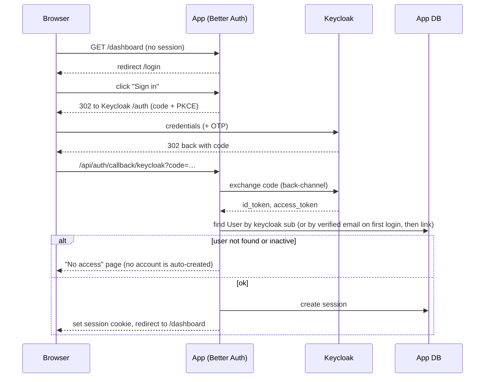

# Authentication & authorization

Decision record: [ADR-0004](adr/0004-keycloak-auth.md). Roles: [../01-product/roles.md](../01-product/roles.md).

## Split of responsibilities

| | Keycloak | App |
|---|---|---|
| Login, passwords, password reset | ✅ | |
| 2FA (TOTP), brute-force protection, password policy | ✅ | |
| Single sign-on / logout | ✅ | |
| User exists & is active | mirrors | ✅ source of truth |
| Roles and their scopes | | ✅ (`UserRole` table) |
| Permission checks | | ✅ (`lib/authz`) |

Why roles live in the app: scopes point at app data (faculty, department, program), role changes
must apply immediately (no stale tokens), and HR/sysadmin manage them in the app UI.

## Keycloak realm

Realm-as-code in `infra/keycloak/realm-logos.json`, imported on first start (PLT-04). Placeholders
(`${APP_URL}`, `${APP_URL_ALT}`, client secrets) are filled from the Keycloak container's
environment; to change the realm in dev run `pnpm infra:reset`. In production change it in the admin
console or export/import deliberately: an existing realm is never overwritten by the import.

| Item | Value |
|---|---|
| Realm | `logos` |
| Web client | `sekretari-web` — confidential, Standard Flow (authorization code) + PKCE S256, redirect `${APP_URL}/api/auth/*`, post-logout redirect `${APP_URL}` |
| Admin client | `sekretari-admin` — confidential, service account only, roles `realm-management: manage-users, view-users, query-users` — used by the app to provision accounts (IAM-01, IAM-02) |
| Self-registration | **off** |
| Login with email | on (username = email) |
| Required actions on new users | `UPDATE_PASSWORD`, `VERIFY_EMAIL` |
| Password policy | min length 10, not username, not email, password history 3 |
| Brute-force detection | on |
| OTP | available; **required for `sysadmin`**: members of group `require-otp` (realm role `require-otp`) must enter a code, and set one up on first use (Q-18). IAM-01 puts sysadmins in the group. |
| Theme | default first; LOGOS branding later |
| Locales | `en`, `sq` |

## Login flow



Rules:
- **No implicit sign-up.** A Keycloak login that doesn't match an active app `User` is rejected.
- First login links the Keycloak `sub` to the pre-created `User` by verified email; later logins
  match by `sub`.
- Session is stored in the app DB (Better Auth), cookie `httpOnly`, `secure` in production,
  `sameSite=lax`. Idle timeout 30 min, absolute 12 h (configurable).
- **Logout** ends both the app session and the Keycloak SSO session (RP-initiated logout with
  `id_token_hint`).
- Deactivating a user in the app (IAM-01) disables the Keycloak user **and** deletes app sessions.

### Implementation (PLT-04)

| | |
|---|---|
| Library | Better Auth 1.7 — `genericOAuth` provider `keycloak`, discovery from `KEYCLOAK_INTERNAL_URL` (Docker) or the issuer, PKCE S256, `disableSignUp`, `requireEmailVerification` |
| Endpoints | `/api/auth/*` (callback `/api/auth/callback/keycloak`), pages `/login`, `/no-access` |
| Code | `src/lib/auth/` — `server.ts` (instance), `session.ts` (`getCurrentUser`, `requireUser`), `actions.ts` (`signInAction`, `signOutAction`), `policy.ts` (pure rules), `keycloak.ts` (URL helpers), `events.ts` (auth events → audit in PLT-07) |
| Gate | `src/proxy.ts` redirects when no session cookie; `requireUser()` is the real check and re-reads `users.active` and the absolute session age on every request |
| Sessions | table `sessions`, sliding idle window `SESSION_IDLE_MINUTES` (30), absolute `SESSION_MAX_HOURS` (12) |
| Dev users | `infra/keycloak/dev/dev-users.json` (password `Dev-Pass-12345`), created by `pnpm infra:up` + `pnpm db:seed` |

## Authorization model

```
User ──< UserRole >── role (enum)
              └── scopeType: INSTITUTION | FACULTY | DEPARTMENT | PROGRAM | SELF
              └── scopeId:   id of the faculty/department/program (null for INSTITUTION/SELF)
```

- **Roles** are a fixed enum in code (list in roles.md).
- **Permissions** are strings `<module>.<resource>.<action>`, e.g. `stu.student.read`,
  `exm.grade.write`, `fin.payment.write`. The role → permissions map is **code**
  (`src/lib/authz/permissions.ts`), reviewed like any other code.
- A check is `can(user, permission, target?)`:
  1. collect the user's role assignments that grant `permission`;
  2. if `target` is given, at least one assignment's scope must **contain** the target
     (institution ⊃ faculty ⊃ department ⊃ program; `SELF` = the user's own student/staff record;
     lecturer "own assignments" = target belongs to one of the lecturer's teaching assignments).
- Helpers: `requireUser()`, `requirePermission(permission, target?)` (throws → 403 page / action
  error), `scopeFilter(user, permission)` (returns a Prisma `where` fragment to restrict lists).
- **List queries must use `scopeFilter`**, so out-of-scope rows never leave the database.

### Implementation (PLT-05)

Code in `src/lib/authz/`: `roles.ts` (enum, allowed scopes per role), `registry.ts` (modules register
`registerPermissions(module, { permissions, grants })`, `registerScopeResolver`,
`registerTargetResolver`), `check.ts` (pure decisions), `guard.ts` (`can`, `assertCan`,
`requirePermission`, `grantScopes`, `permissionsFor`), `assignments.ts` (`assignRole`,
`revokeRole`), `client.tsx` (`PermissionsProvider`, `useCan`). Assignments are read per request
and never cached across requests. The role → permissions map is therefore not one file but each
module's registration (platform ones in `permissions.ts`).

## Account provisioning (IAM-01, IAM-02)

The app creates/updates/disables Keycloak users through the Keycloak Admin REST API using the
`sekretari-admin` service account:

| Event | App action | Keycloak action |
|---|---|---|
| Admin creates staff user | create `User` + `UserRole`s | create user, send "set password / verify email" email |
| Student enrolled (IAM-02) | create `User` (role `student`, scope `SELF`) | create user, send activation email |
| User deactivated | `User.active=false`, delete sessions | disable user, logout sessions |
| Student graduates/deregisters (IAM-02) | deactivate | disable (alumni have no access, SRC-037) |

Failures to reach Keycloak must not leave half-created users: create in Keycloak first, then the
app row in a transaction; on app failure, delete the Keycloak user (compensating action).

## Development note — issuer URL inside Docker

The browser reaches Keycloak at `http://localhost:8080`, but a containerized app reaches it at
`http://keycloak:8080`. Tokens carry the **browser-facing** issuer, so:
- **Dev default:** run the app on the host (`pnpm dev`) and only infra in Docker — no mismatch.
- **Full-stack Docker:** set Keycloak `KC_HOSTNAME` to the public URL and
  `KC_HOSTNAME_BACKCHANNEL_DYNAMIC=true`; the app uses the public issuer for validation and the
  internal URL for back-channel calls. Details in [deployment.md](deployment.md).
