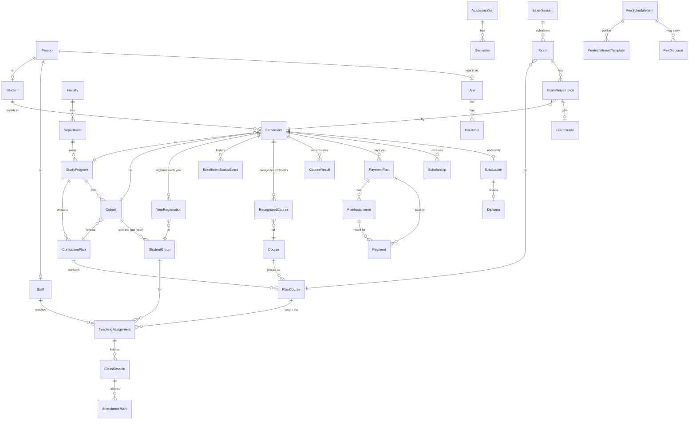

# Domain model (conceptual)

This is the **shared map** of entities so features stay consistent. It is conceptual: exact
columns, constraints and indexes are designed in each feature's spec and live in
`prisma/schema/<module>.prisma`. When a spec changes an entity here, update this file in the same
change.

Terms: [../01-product/glossary.md](../01-product/glossary.md).

## Core rules

1. **Academic-year scoping** (SRC-001, ADR-0006). Records that change year to year carry
   `academicYearId`: groups, yearly registrations, teaching assignments, calendar events, exam
   sessions, syllabi, approved templates. Finance amounts are reported by **calendar year** (dates
   on installments/payments), but each payment plan is still linked to the academic year it pays for.
2. **Person is shared.** Students and staff are both `Person`s (one person can be both — e.g. a
   lecturer doing a master's). Personal data lives once on `Person`.
3. **Status changes are events.** Enrollment status, grade changes and approvals keep history rows;
   the current value is denormalized on the main row for fast queries.
4. **Approved = immutable.** Approved curriculum plans, finalized grades, issued documents are
   never edited in place; changes create a new version/correction row.
5. **IDs** are `cuid2` strings (`id`), plus human codes where users need them (program code, NIM,
   document numbers). Every table has `createdAt`, `updatedAt`; business tables also
   `createdById`, `updatedById`.

## Entity map

## Entities by module

### PLT / IAM — platform
| Entity | Purpose |
|---|---|
| `User` | Login identity in the app; `keycloakId`, `email`, `active`, optional `personId`. |
| `UserRole` | Role assignment: `role`, `scopeType`, `scopeId`, `validFrom/To`. |
| `Session`, `Account`, `Verification` | Better Auth tables (names per library). |
| `AuditLog` | `actorId`, `action`, `entityType`, `entityId`, `before`, `after` (JSON), `ip`, `at`. |
| `StoredFile` | `storageKey`, `purpose`, `fileName`, `mimeType`, `size`, `sha256`, `status` (PENDING/ATTACHED), `entityType`/`entityId`, `uploadedById`, `deletedAt`. |
| `DocumentTemplate` | Versioned HTML templates for PDFs, per `type` and validity (academic year). |
| `Notification` | In-app notification per user: `type`, `payload`, `readAt`. |
| `EmailOutbox` | Queued/sent emails with status, for traceability. |
| `FormDefinition` / `FormSubmission` / `FormSubmissionEvent` | Forms engine (ADR-0009, PLT-15 implemented): versioned JSON definitions (one PUBLISHED per key, frozen once published), submissions with a reference code and JSON answers, history events; `RateLimitHit` backs the public rate limit. |
| `DocumentTemplate` / `DocumentCounter` / `IssuedDocument` | PDF engine (ADR-0007, PLT-09 implemented): versioned HTML templates per type and language (frozen once published), an atomic counter per type and year, and numbered, stored, never-edited issued documents with a verification code (cancelled, never deleted). |
| `Syllabus` | Syllabus (PDF) of a plan course for an academic year (CUR-03 implemented): versions, `DRAFT`/`APPROVED`/`ARCHIVED`, one approved per course and year (partial unique index), frozen once approved (trigger). |
| `IssuedDocument` type `cur.study-package` | CUR-06 implemented, no new table: the study package (cover and plan table from the template, then the approved syllabi merged) is an `IssuedDocument` with `subjectType = "Enrollment"` and `subjectId = enrollmentId`. |
| `BackupRun` | One run of the full export or the integrity check (PLT-13 implemented): `kind` (EXPORT/INTEGRITY), `status`, counts, `sizeBytes`, `sha256` and `fileName` of the ZIP under `<FILES_DIR>/exports/`, `purgedAt` once retention removed the file, short `errorCode`; never deleted. For an integrity run `tableCount` holds the number of retained exports checked. |
| `SavedFilter` | A user's named table filter: `userId`, `tableId`, `name`, `query` (PLT-10). |
| `SystemSetting` | Runtime settings: `key` (PK) → JSON `value`, `updatedAt`, `updatedById` (PLT-03, implemented). |

### ORG — structure
| Entity | Key fields |
|---|---|
| `AcademicYear` | `code` ("2026-2027"), `startDate`, `endDate`, `status` (PLANNED/CURRENT/CLOSED) |
| `Semester` | `academicYearId`, `number` (1/2), dates |
| `Faculty` | `code` (unique, upper case), `name`, `nameEn?`, `active` |
| `Department` | `facultyId` (fixed), `code` (unique, upper case), `name`, `nameEn?`, `active`; `headStaffId?` arrives with HR-01 (until then the head is derived from `UserRole`) |
| `StudyProgram` | `departmentId` (fixed), `code` (unique), `name`, `nameEn?`, `cycle` (FIRST/SECOND), `subtype?` (Master only, from settings), `durationYears` (1/2/3, allowed values per cycle from settings), `totalCredits` (1–600), `active`; `coordinatorStaffId?` arrives with HR-01 (until then derived from `UserRole`) |
| `Cohort` | (ORG-04, implemented) `programId`, `startAcademicYearId`, `curriculumPlanId` (an approved plan of the same program), `name` (unique per program and start year), `active`. |
| `StudentGroup` | (ORG-04, implemented) `cohortId`, `academicYearId`, `yearOfStudy`, `name` (unique per cohort, year and year of study), `capacity?` (informational), `active`. |

### CUR — curriculum
| Entity | Key fields |
|---|---|
| `CourseCategory` | `code`, `nameSq`, `nameEn`, `active` (administrator-maintained list, Q-28) |
| `Course` | `code` (unique), `name`, `nameEn?`, `defaultCredits` (0–60), `categoryId?`, `hoursLecture`, `hoursSeminar`, `hoursLab` (0–500), `departmentId`, `active` |
| `CurriculumPlan` | (CUR-02, implemented) `programId`, `version` (per program), `validFromAcademicYearId`, `status` (DRAFT/APPROVED/ARCHIVED), `notes?`, `approvedAt/ById`, `archivedAt`. Approved and archived plans are frozen by database triggers. |
| `PlanCourse` | (CUR-02, implemented) `planId`, `courseId` (unique per plan), `yearOfStudy`, `semester` (1/2), `credits`, `categoryId?`, hours (lecture/seminar/lab), `isElective`; defaults copied from the catalog when added. |
| `Syllabus` | `planCourseId`, `academicYearId`, `fileId` or structured content, `status` |
| `TeachingAssignment` | (CUR-04, implemented) `groupId`, `planCourseId`, `staffId`, `kind` (LECTURE/SEMINAR/LAB), `semester` (of the plan course), `plannedHours`; unique per group, plan course, kind and lecturer. |
| `ApprovedDocument` | Archive of approved plan/syllabus/diploma & supplement forms per academic year (SRC-111/112) |

### STU / ADM — students & admissions
| Entity | Key fields |
|---|---|
| `Person` | (HR-01, STU-01; implemented) `firstName`, `lastName`, `fatherName?`, `gender` (FEMALE/MALE), `birthDate`, `nationalId?` (unique), `phone?`, `email?` (unique), `address?`, `birthPlace?`, `residence?`. `User.personId` points at it. |
| `Lead` | interest-form contact: name, email, phone, program of interest, source (website/campaign/event), consent |
| `Application` | `personData` (snapshot), `programId`, `academicYearId`, `highSchoolAverage`, documents, `status` (SUBMITTED/IN_REVIEW/ACCEPTED/REJECTED/ENROLLED) |
| `RegistrationNotice` | (ADM-06, implemented) `announcementId` (unique; the notice is an NTF-01 announcement for audience ALL), `academicYearId`, `programId?`, `registrationDeadline` (date), `documents` (text[], ≤ 20 by check), `contractExcerpt`, `showFees`. Fees and preferential days are read live from `FeeScheduleItem`/`FeeDiscount`, never copied. |
| `Student` | (STU-01, implemented) `personId` (unique), `studentNumber` (6-digit sequence, generated), `nim?` (unique, typed from SMIAL until INT-01). |
| `Enrollment` | (STU-01, implemented) `studentId`, `programId`, `cohortId`, `registrationType` (FIRST_TIME/SECOND_PROGRAM/TRANSFER), `status` (ACTIVE/SUSPENDED/DEREGISTERED/GRADUATED), `startedAt`, `endedAt?`; one ACTIVE or SUSPENDED per student and program (partial unique index). |
| `YearRegistration` | (STU-01, implemented) `enrollmentId`, `academicYearId`, `yearOfStudy`, `groupId`; unique per enrollment and year. |
| `EnrollmentStatusEvent` | (STU-01 creates the first row; STU-02 the transitions) `enrollmentId`, `fromStatus?`, `toStatus`, `reason?`, `effectiveDate`, `documentRef?`. |
| `RecognizedCourse` | (STU-07) `studentId`, `enrollmentId`, `submissionId` (the recognition request), `courseId`, `credits`, `note?`, `voidedAt?`/`voidedById?`/`voidReason?`; never deleted, one live row per enrollment and course (partial unique index); read by EXM-07. |

### CAL / ATT — calendar, timetable, attendance
| Entity | Key fields |
|---|---|
| `CalendarEvent` | (CAL-01, implemented) `academicYearId`, `type` (TEACHING_WEEK/HOLIDAY/DEADLINE/EXAM_PERIOD/REGISTRATION_PERIOD/EVENT), `title`, `startDate`/`endDate` (inclusive, all-day), `description`, `audience` (ALL/CYCLE/PROGRAM) with `cycle`/`programId`, `active` (cancelled, never deleted). |
| `CalendarFeedToken` | (CAL-01) one per user: hash of the secret iCal link. |
| `TimetableEntry` | `teachingAssignmentId`, `weekday`, `startTime`, `endTime`, `room`, `validFrom/To` |
| `ClassSession` | `assignmentId`, `date`, `startMinute`, `endMinute`, `hours` (whole academic hours), `topic`, `status` (PLANNED/HELD/CANCELLED), `timetableEntryId?`, `heldAt` — basis for attendance and delivered hours (HR-04); never deleted, only cancelled (ATT-01) |
| `AttendanceMark` | `sessionId`, `studentId`, `status` (PRESENT/ABSENT/EXCUSED), `note`, `markedById` — one per roster student per session (ATT-01) |

### EXM — exams & grades
| Entity | Key fields |
|---|---|
| `GradingScheme` | scale, pass mark, rounding, component weights (Q-11) |
| `AssessmentComponent` / `AssessmentResult` | partial assessments per teaching assignment and their results |
| `ExamSession` | (CAL-03, implemented) `academicYearId`, `type` (WINTER/SUMMER/AUTUMN/MINI), `startDate`/`endDate`, `publishedAt?`; unique per year and type; never deleted |
| `Exam` | (CAL-03, implemented as `ExamSitting`) `sessionId`, `planCourseId`, `date`, `startMinute`/`endMinute`, `room`, `note`; unique per session and plan course; examiners in `ExamSittingExaminer` (`sittingId`, `staffId`) |
| `ExamRegistration` | `examId`, `enrollmentId`, `attemptType` (FIRST/RETAKE/BACKLOG/IMPROVEMENT), `eligible`, `ineligibleReason` |
| `ExamGrade` | `examRegistrationId`, `value`, `status` (DRAFT/SUBMITTED/FINAL), `finalizedAt`; corrections as `ExamGradeCorrection` |
| `ExamRecord` | generated procesverbal: `examId`, `fileId`, `signedFileId?`, status |
| `CourseResult` | `enrollmentId`, `planCourseId`, `finalGrade`, `creditsEarned`, `countingExamGradeId` — the academic achievement register (SRC-040) |

### FIN — finance
| Entity | Key fields |
|---|---|
| `FeeScheduleItem` | (FIN-01) `programId`, `academicYearId`, `kind` (TUITION/ADMINISTRATIVE/DIPLOMA/BACKLOG_EXAM/OTHER), `label`, `amount` Decimal(12,2), `active` — unique per program × year × kind × label; never deleted (Q-85) |
| `FeeInstallmentTemplate` / `FeeDiscount` | (FIN-01) installments (`sequence`, `dueDate`, `amount`; they add up to the fee, Q-86) and early-payment discounts (PERCENT/AMOUNT `value`, `validFrom`..`validTo`, Q-87) of a fee |
| `StudentContract` | `enrollmentId`, `academicYearId`, number, `fileId` |
| `PaymentPlan` / `PlanInstallment` | (FIN-01) one plan per enrollment × academic year, copied from the fee schedule; installments carry `kind`, `label`, `dueDate`, `amount`, `earlyAmount`/`earlyUntil`, `status` (ACTIVE/CANCELLED), `scheduleItemId?`; adjusted or cancelled with a reason and audited, never deleted (Q-88, Q-89) |
| `Payment` | (FIN-02) on a `PaymentPlan`: `amount`, `paidOn`, `reference`, `method` (CASH/BANK_TRANSFER/CARD/OTHER), `installmentId?` (the installment it is meant for), `status` (RECORDED/VOIDED, `voidReason`), `importBatch?`; never deleted. Allocation to installments, balances and financial clearance are **computed** (`domain/payment-rules.ts`), not stored (Q-109…Q-113) |
| `Scholarship` | `enrollmentId`, `academicYearId`, `type` (FULL/PARTIAL), `percent`/`amount`, `reason` |
| `FinancialClearance` | computed view: per enrollment & exam session — cleared yes/no (SRC-049) |

### DOC / GRD — documents & graduation
| Entity | Key fields |
|---|---|
| `DocumentRequest` | `requesterId`, `type`, `purpose`, `status` |
| `IssuedDocument` | `type`, `number`, `protocolNumber?`, `fileId`, `issuedAt`, `issuedById`, `verificationCode` |
| `Graduation` | `enrollmentId`, `clearedAt`, `thesisTitle?`, `finalAverage` |
| `Diploma` | `graduationId`, `number`, `issuedAt`, `diplomaFileId`, `supplementFileId` |

### HR / OFF — staff & administration
| Entity | Key fields |
|---|---|
| `Staff` | (HR-01, implemented) `personId` (unique), `kind` (ACADEMIC/ADMINISTRATIVE), `category` (PAE/PAK/VOLUNTEER), `degree?`, `title?`, `departmentId?`, `retired`, `primaryEmployer?` (PAK only), `contractStart`, `contractEnd?`, `active` (employment ended = false; never deleted). |
| `EmploymentContract` | `staffId`, `type`, `startDate`, `endDate`, `fileId` |
| `PerformanceEvaluation` | `staffId`, `evaluatorId`, `period`, form submission ref, `score` |
| Staff requests | (OFF-01, implemented) no table of their own: `FormSubmission` rows of the forms `staff-leave`, `staff-supplies`, `staff-certificate`, `staff-authorization` (handler `off.request`). The chain is in the definition: transitions name the `roles` that may take them, and `submitRoles` limits who may fill the form in (PLT-15 additions). History per staff member = the submissions of the account. |

### QA / ERS / LIB / NTF
| Entity | Key fields |
|---|---|
| `EvalCampaign` | (QA-01, implemented) `academicYearId`, `name` (unique per year), `status` (DRAFT/OPEN/CLOSED), `questions` (JSON list: key, section LECTURER/ADMINISTRATION, type SCALE/TEXT, labels sq/en, required), `openedAt?`, `closedAt?`; questions frozen once open. |
| `EvalParticipation` | (QA-01) who answered what, never how: `campaignId`, `studentId`, `targetKey` (assignment id or `ADMIN`), `assignmentId?`, `completedOn` (date only); unique per campaign, student and target. |
| `EvalResponse` | (QA-01) how a target was answered, never by whom: `campaignId`, `assignmentId?`, `section`, `answers` (JSON); deliberately no student, no timestamp, no link to the participation. Shown only for closed campaigns and only with at least `qa.minResponses` (5) responses. |
| `AlumniRecord` | `personId`, employment/further-studies updates over time |
| `ErasmusApplication` | (ERS-01, implemented) no table: a `FormSubmission` of one of the six `erasmus-*` form definitions (`erasmus-student`, `-academic`, `-admin`, each public and `-portal`); states `submitted` → `shortlisted` → `selected` → `mobility_done` or `rejected`; the applicant kind, destination and period come from the form key and answers; the known student / staff is looked up, not stored (Q-97). |
| `LibraryCardRequest`, `LibraryClearance` | depends on PLEJADES (Q-03) |
| `Announcement` | (NTF-01, implemented) `title`, plain-text `body`, `status` (DRAFT/PUBLISHED/ARCHIVED), `audience` (ALL/STAFF/STUDENTS/CYCLE/PROGRAM) with `cycle`/`programId`, `publishAt`, `expiresAt`, `pinned`, `emailPush`, `pushedAt`; attachments are `StoredFile` rows (`entityType = Announcement`). |
| `Message` | (NTF-03, implemented) one send to the people of a list: `subject`, plain-text `body` (placeholders `{firstName}`, `{lastName}`, `{fullName}`), `sourceTable` (PLT-10 table id), `filters` (JSON), `status` (PENDING/SENT), `recipientCount`, `noAccountCount`, `createdById`, `completedAt`. Never edited or deleted. |
| `MessageRecipient` | (NTF-03) delivery log, one row per `Person` per message (unique): `userId?`, `state` (QUEUED/DELIVERED/NO_ACCOUNT), `notificationId?`, `emailOutboxId?`. No addresses. |
| `MessageTemplate` | (NTF-03) saved wording: `name`, `subject`, `body`, `archivedAt?` (archived, never deleted). |
| `Event` | (NTF-02, implemented) `title`, plain-text `description`, `location`, `startsAt`, `endsAt?`, `capacity?` (null = unlimited), `registrationDeadline?` (default: the start), `status` (DRAFT/PUBLISHED/CANCELLED), `audience` (as `Announcement`) with `cycle`/`programId`, `announcementId?`, `remindedAt?`. Cancelled, never deleted. |
| `EventRegistration` | (NTF-02) one row per `User` and `Event` (unique): `status` (REGISTERED/CANCELLED), `registeredAt`, `cancelledAt?`. Cancelling keeps the row; registering again reuses it. |
