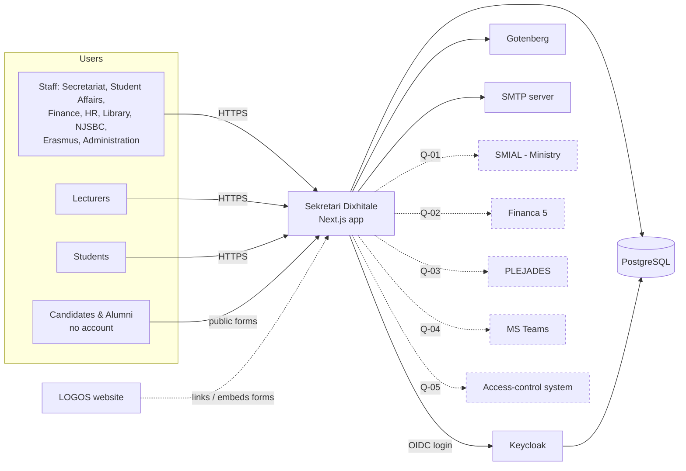
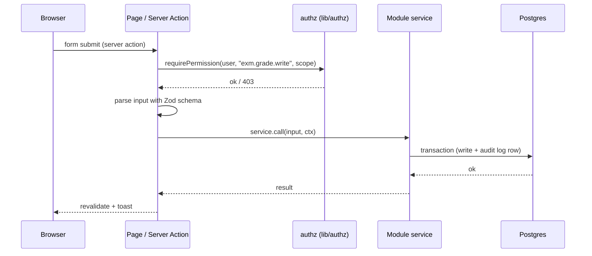

# Architecture overview

## Stack

| Concern | Choice | Decision |
|---|---|---|
| Web framework | **Next.js** (App Router), React, TypeScript (strict) | [ADR-0002](adr/0002-nextjs-modular-monolith.md) |
| Database | **PostgreSQL** | [ADR-0003](adr/0003-postgres-prisma.md) |
| ORM / migrations | **Prisma** (multi-file schema, one file per module) | [ADR-0003](adr/0003-postgres-prisma.md) |
| Identity provider | **Keycloak** (OIDC) | [ADR-0004](adr/0004-keycloak-auth.md) |
| Auth library in app | **Better Auth** (generic OIDC provider → Keycloak) | [ADR-0004](adr/0004-keycloak-auth.md) |
| Authorization | App-side RBAC with scopes, stored in app DB | [ADR-0004](adr/0004-keycloak-auth.md) |
| Deployment | **Docker Compose** | [ADR-0005](adr/0005-docker-compose.md) |
| PDF generation | **Gotenberg** (HTML → PDF via Chromium), container in the stack | [ADR-0007](adr/0007-pdf-gotenberg.md) |
| Background jobs | **pg-boss** (Postgres-backed queue + cron) | [ADR-0008](adr/0008-jobs-pg-boss.md) |
| Forms | Generic forms engine (JSON definitions, Zod validation) | [ADR-0009](adr/0009-forms-engine.md) |
| File storage | Storage interface; local Docker volume first | [ADR-0010](adr/0010-file-storage.md) |
| i18n | **next-intl**, all UI strings in message catalogs | [ADR-0011](adr/0011-i18n.md) |
| UI | Tailwind CSS + shadcn/ui, TanStack Table, React Hook Form + Zod | [conventions.md](conventions.md) |
| Email | SMTP (Mailpit in development) | [deployment.md](deployment.md) |
| Tests | Vitest (unit + integration against real Postgres), Playwright (E2E) | [conventions.md](conventions.md) |
| Package manager | pnpm | |

> Versions are not pinned in the docs. Use the current stable release at implementation time and
> **check the library's current documentation** — don't rely on memory for APIs that change
> (Next.js, Better Auth, Prisma, Keycloak).

## System context



Dashed integrations are **blocked** until their open question is answered
([../04-open-questions.md](../04-open-questions.md)).

## Application structure — modular monolith

One Next.js application, split internally into **modules** that mirror the feature registry
prefixes. Modules talk to each other only through their exported service functions — never by
reaching into another module's tables from UI code.

```
src/
  app/                          # Next.js routing only — thin pages/layouts
    (public)/                   # no login: public forms, document verification
    (app)/                      # logged-in area, uses the app shell
      <module>/...              # e.g. students/, exams/, finance/
    api/                        # route handlers: auth callback, file download, integrations, cron
  modules/
    <module>/                   # org, cur, stu, adm, cal, att, exm, doc, grd, fin, hr, lib, qa, ers, off, ntf, int, rpt, iam
      domain/                   # types, Zod schemas, pure business rules (no I/O) — unit tested
      server/                   # services (DB access, transactions), queries, server actions
      ui/                       # module-specific React components
      index.ts                  # public API of the module (what other modules may import)
  lib/                          # cross-cutting platform code
    auth/  authz/  db/  audit/  i18n/  storage/  pdf/  jobs/  mail/  forms/  tables/
  components/ui/                # shadcn/ui primitives
prisma/
  schema/                       # one .prisma file per module + base.prisma
  migrations/
  seed/                         # seed scripts (dev/demo data, reference data)
infra/
  keycloak/                     # realm export (realm-as-code)
  postgres/                     # init scripts (create app + keycloak databases)
  docker/                       # Dockerfiles, compose overrides
docs/                           # this documentation
scripts/                        # repo tooling (features.mjs, …)
```

Module code ↔ registry prefix: `PLT` → `src/lib/*`, `IAM` → `modules/iam`, `ORG` → `modules/org`,
and so on (lowercase prefix).

## Request flow (mutation)



Rules:
- **Every** server action and route handler starts with an authorization check.
- **Every** mutation of business data writes an audit row in the same transaction (PLT-07).
- Validation schemas live in `domain/` and are shared by the form (client) and the action (server).

## Cross-cutting concerns

| Concern | Where | Feature |
|---|---|---|
| Login/session | `lib/auth` | PLT-04 |
| Permissions & scopes | `lib/authz` | PLT-05 |
| Audit log | `lib/audit` | PLT-07 |
| Files | `lib/storage` | PLT-08 |
| PDFs | `lib/pdf` | PLT-09 |
| Tables, filters, export | `lib/tables` | PLT-10 |
| Notifications (in-app + email) | `lib/mail`, `modules/ntf` | PLT-11 |
| Jobs & schedules | `lib/jobs` | PLT-12 |
| Backups & export | `infra/`, scripts | PLT-13 |
| Forms engine | `lib/forms` | PLT-15 |

## Related documents

- [auth.md](auth.md) — Keycloak realm, login flow, roles and scopes
- [deployment.md](deployment.md) — Docker Compose services and environments
- [domain-model.md](domain-model.md) — entities and relationships
- [conventions.md](conventions.md) — coding rules every feature follows
- [adr/](adr/) — architecture decisions
