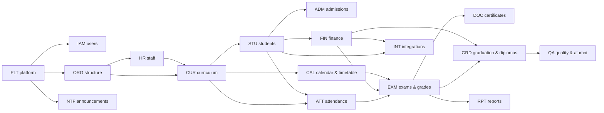

# Roadmap

No fixed dates (no deadline pressure, decision 2026-10-03). The order comes from **dependencies**
and **blockers** in [03-features/FEATURES.md](03-features/FEATURES.md); live readiness counts are in
its Summary section (`node scripts/features.mjs`).

## How phases work

- A phase is a **coherent, usable increment**: at the end of it, some office can start using the
  system for real work.
- Inside a phase, build features in **dependency order** — the registry lists them in that order.
- A **blocked** feature does not hold its phase hostage: the phase closes without it, and the
  feature is built as soon as its question is answered (it stays in its phase table, marked 🔴/🟠).
- Questions should be asked **one phase ahead**, so answers are there when the phase starts —
  see "Ask before" below.

## Module dependency map

## Phases

| Phase | Theme | Usable outcome at the end | Features | Ask before starting |
|---|---|---|---|---|
| **P0** | Foundation | Staff can log in via Keycloak; sysadmin manages users and roles; everything is audited. | PLT-01…07, IAM-01 | — (Q-17, Q-18 answered) |
| **P1** | Academic structure & people | Faculties, departments, programs, plans, syllabi, staff, teaching assignments, student register and academic calendar are maintained in the system. | PLT-08, PLT-10, PLT-13, ORG-01…04, CUR-01…04, HR-01, STU-01, CAL-01 | Q-14 (existing data — to load real data) |
| **P2** | Admissions & student lifecycle | Candidates apply online; Student Affairs and Secretariat process applications and enroll students; students have portal accounts; status changes, standard lists, announcements. | PLT-11, PLT-12, PLT-15, NTF-01, NTF-03, STU-02…07, IAM-02, ADM-01…04, ADM-06, INT-06 | Q-13 (ranking) — Q-06, Q-19, Q-20 answered |
| **P3** | Finance basics | Fees, payment plans, payments (manual/CSV), scholarships, reminders, shared Finance/Secretariat lists; contracts. | PLT-09, FIN-01…05, ADM-05 | Q-24 (fees), Q-23 (scholarships), Q-10 (contracts), Q-02 (F5) |
| **P4** | Teaching & assessment | Timetables, attendance, exam sessions, eligibility, rosters, grade entry, academic record, averages, session reports; lecturer workspace. | CAL-02, CAL-03, ATT-01, ATT-02, HR-07, EXM-01…10 | **Q-11 (grading), Q-12 (eligibility)**, Q-08 (exam documents, anonymous marking) |
| **P5** | Documents & graduation | Certificates on request, graduation clearance, diplomas & supplements, official registers, plan/syllabi packages, approved-documents archive. | CUR-06, CUR-07, DOC-01…03, GRD-01…03 | Q-07 (certificates), Q-09 (diplomas & registers) |
| **P6** | HR & administration | Contracts, expiry tracking, delivered hours, HR lists, evaluations, staff requests, teaching-load report, payroll export. | HR-02…06, CUR-05, OFF-01, FIN-06 | Q-22 (hours), Q-02 (F5 payroll) |
| **P7** | Quality, Erasmus, library & events | Student evaluations, alumni tracking, Erasmus applications, events, library features. | QA-01…03, ERS-01, NTF-02, INT-03, LIB-01…03 | Q-03 (PLEJADES), Q-15 (staff quality) |
| **P8** | Integrations, reporting & compliance | SMIAL, F5, Teams, access-control integrations; report builder; data-protection controls; legacy migration. | INT-01, INT-02, INT-04, INT-05, INT-07, RPT-01, PLT-14 | Q-01, Q-02, Q-04, Q-05, Q-14, Q-16 |

## Critical questions

These gate the largest parts of the system — chase them first:

1. **Q-11 Grading rules + Q-12 Eligibility rules** — together they unblock the whole exam chain
   (EXM-02…08) and, through it, transcripts, graduation, diplomas, alumni tracking and reports.
   Neither alone is enough.
2. **Q-07 / Q-08 / Q-09 Templates** — collect sample documents (certificates, procesverbal, grade
   sheet, course register, diploma, supplement, registers) in one request to the Secretariat.
3. **Q-10 Contracts** — student contract with annex, employment contract (Finance/HR).
4. **Q-14 Existing data** — determines whether INT-07 must be pulled forward into P1/P2.
5. **Q-03 PLEJADES** — the only blocker for the whole library module.

A ready-to-send questionnaire for the university can be produced from
[04-open-questions.md](04-open-questions.md) (ask Claude: "turn the open questions into a
questionnaire for LOGOS, grouped by office").

## Releases

Suggested go-live points (each after a phase, with real data loaded):

| Release | After | Who starts using it |
|---|---|---|
| R1 | P1 | Secretariat, HR, departments — structure, curriculum, staff and student records |
| R2 | P2 | Student Affairs, candidates, students (portal) — admissions season |
| R3 | P3 | Finance |
| R4 | P4 | Lecturers, Secretariat — first exam session run in the system |
| R5 | P5 | Secretariat — certificates and the first graduating cohort |
| R6+ | P6–P8 | HR, Administration, NJSBC, Erasmus, Library, management reporting |

## Keeping this roadmap honest

- After each feature: set its Status in FEATURES.md, run `node scripts/features.mjs --write`.
- After each answered question: `/answer Q-xx …` (updates the questions file and readiness).
- When a phase closes, note the date here and move any blocked leftovers to the "carried" list below.

### Phase log

| Phase | Started | Closed | Carried (blocked) features |
|---|---|---|---|
| P0 | — | — | — |
