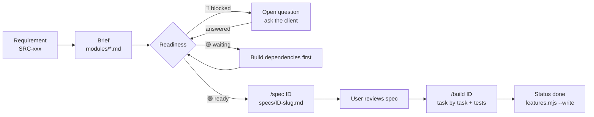

# Documentation

Spec-driven documentation for **Sekretari Dixhitale**, the academic administration system of
Kolegji Universitar LOGOS. Written so that features can be implemented with Claude Code one at a
time ([ADR-0001](02-architecture/adr/0001-spec-driven-docs.md)).

## Map

| Folder | Read it when you need… |
|---|---|
| [00-source/](00-source/) | what the client asked for — [English translation](00-source/requirements-en.md) with `SRC-xxx` IDs, [Albanian original](00-source/requirements-sq.md), and the original `.docx` |
| [01-product/](01-product/) | the [vision](01-product/vision.md), [roles & access](01-product/roles.md), [glossary](01-product/glossary.md) (Albanian ↔ English ↔ code names) |
| [02-architecture/](02-architecture/) | [overview](02-architecture/overview.md), [auth](02-architecture/auth.md), [deployment](02-architecture/deployment.md), [domain model](02-architecture/domain-model.md), [conventions](02-architecture/conventions.md), [ADRs](02-architecture/adr/) |
| [03-features/](03-features/) | the [feature registry](03-features/FEATURES.md) (status, dependencies, blockers), [module briefs](03-features/modules/), [full specs](03-features/specs/) |
| [04-open-questions.md](04-open-questions.md) | what we don't know yet and which features it blocks |
| [05-roadmap.md](05-roadmap.md) | build order (phases P0–P8) and which questions to ask before each phase |

## How a feature moves

- **Status** (`todo → specced → in-progress → done`) is set by hand in FEATURES.md.
- **Readiness** (🟢 ready · 🟡 waiting · 🔴 blocked · 🟠 blocked-dep · ✅ done) is computed by
  `node scripts/features.mjs --write` from dependencies and open blocking questions.

## Conventions for these docs

- English. Albanian terms only where they are the official name (glossary explains them).
- Every requirement-driven statement cites its `SRC-xxx`.
- One fact in one place: statuses only in FEATURES.md, answers only in 04-open-questions.md,
  decisions in ADRs. Other docs link instead of copying.
- Diagrams in Mermaid, tables over prose.
